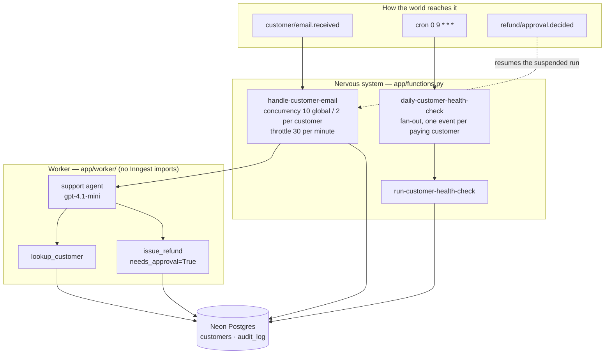

# AI Agent Nervous System

A customer-support agent that survives crashes, waits four hours for a human, and never issues the same refund twice.

The agent itself is small and unremarkable: an [OpenAI Agents SDK](https://openai.github.io/openai-agents-python/) agent that reads a customer from Postgres, drafts a reply to their email, and can issue a refund. What makes it a *worker* rather than a script is everything wrapped around it — event triggers, durable execution, flow control, and an approval gate that outlives the process holding it.

Built with [Inngest](https://www.inngest.com/) and [Neon](https://neon.com/) through the [AI Agent Nervous System crash course](https://agentfactory.panaversity.org/docs/ai-agent-nervous-system-crash-course) on The AI Agent Factory.

---

## The one design rule

**Nothing under `app/worker/` imports Inngest.**

The worker is plain async Python: functions that take arguments and return values. The durable layer in [`app/functions.py`](app/functions.py) calls those functions from inside steps. The agent does not know it is being made durable, retried, rate-limited, or suspended.

That separation is the point. Swap Inngest for Temporal or Restate and the worker does not change. It also keeps the interesting question honest: every durability guarantee below is provided by the wrapper, not smuggled into the business logic.

---

## Architecture



Inside `handle-customer-email`, every unit of work is its own step, so a failure late in the run does not redo the work already finished:

```
audit-ingress → draft-reply → audit-refund-requested → notify-reviewer
              → await-refund-approval  ⏸  (up to 4 hours)
              → audit-decision → [audit-refund-blocked] → resume-after-decision
              → audit-reply-after-decision
```

---

## What each layer buys you

| | Layer | What changed | Commit |
|---|---|---|---|
| **D0** | The worker | An agent that drafts replies and gates refunds behind a human. Runs by hand. | [`1e622ea`](../../commit/1e622ea) |
| **D1** | Durable execution | The agent call moves inside `step.run`. Its result is memoized; a retry does not re-run it or re-bill it. | [`a44b601`](../../commit/a44b601) |
| **D2** | Event trigger | The worker stops being run by hand. An event wakes it, with an audit step before the agent and one after. | [`4567bf3`](../../commit/4567bf3) |
| **D3** | Cron fan-out | A daily cron emits one event per paying customer. Each child is its own isolated, independently retried run. | [`330c7d4`](../../commit/330c7d4) |
| **D4** | Flow control | Concurrency caps and a throttle, sized against the connection pool and the model's per-minute quota. | [`3d81e68`](../../commit/3d81e68) |
| **D5** | Durable human-in-the-loop | The refund pause survives a crash, a deploy, and a reviewer who takes four hours. | [`9e5e584`](../../commit/9e5e584) |
| **D6** | The proof | A per-run diagnostic showing memoization holding while a later step retries. | [`7f225c0`](../../commit/7f225c0) |

Each commit message explains why the code looks the way it does, including the mistakes that shaped it.

---

## The part that actually matters: the durable pause

The Agents SDK already stops at `issue_refund` and raises an approval interruption. But that pause lives only as long as the process holding it. A crash, a deploy, or a reviewer at lunch loses it.

`draft-reply` returns the serialized `RunState` as its step output, so **Inngest** holds the paused agent, not the function host:

```python
decision = await ctx.step.wait_for_event(
    "await-refund-approval",
    event=DECISION_EVENT,
    timeout=APPROVAL_WINDOW,              # four hours
    if_exp=f"async.data.customer_id == '{customer_id}' "
           f"&& async.data.run_id == '{run_id}'",
)
```

Two details that are easy to get wrong:

- **The filter matches the run, not just the customer.** On the customer alone, an approval meant for one refund would release any other refund pending for that customer — the wrong money on the wrong order.
- **A suspended run holds no concurrency slot.** Inngest counts executing *steps*, and a run parked in `wait_for_event` is executing nothing. That is what makes a four-hour human pause affordable rather than a leak.

**Measured, not assumed:** a run was parked at the gate, the function host process was then replaced (new pid, created two minutes after the run suspended), and the decision still completed it with exactly one `refund_issued` row.

---

## Prove it yourself

With both processes running (see below):

```bash
uv run python -m scripts.decide_refund --approve
```

The run parks at `await-refund-approval` with status `WAITING`, the decision resumes it, and the audit trail reads `email_received → refund_requested → refund_approved → refund_issued → reply_drafted`.

```bash
uv run python -m scripts.decide_refund --reject
```

`refund_rejected → refund_blocked`, no `refund_issued`, and the reply says the refund was declined rather than implying it is on its way. That wording is not luck — it comes from the `rejection_message` fed back to the model. Without it, the agent cheerfully promised to process the refund "as soon as it is authorized".

```bash
uv run python -m scripts.burst_emails
```

Twenty emails across five customers, then a reconstruction from the dev server's traces of how many steps were executing at each instant:

```
  umbrella  |################                                        |
  umbrella  |     #############                                      |
  umbrella  |                    ###########                         |
  umbrella  |                       ###############                  |
  ...
  global: 10 of 10 allowed -> within the cap
  accounts@umbrella.example  2 of 2 allowed -> ok
  billing@acme.example       2 of 2 allowed -> ok
```

Each customer gets two at a time; the rest queue. All twenty complete, with exactly one row in and one row out per run.

```bash
uv run python -m scripts.run_trace <run_id>
```

The durability diagnostic, and deliberately **per-run**. Counting audit rows per customer tells you nothing — two runs for one customer are supposed to write two ingress rows. What must never happen is one step running twice inside one run:

```
run 01KYJHVXSGDCR90KF0QRDS5EMV   FAILED   284.6s
  step                        op        status      attempts  took
  audit-ingress               RUN       COMPLETED   1         1.9s
  draft-reply                 RUN       FAILED      5         282.5s
  audit_log rows written by this run: 1
```

The agent step burned five attempts over four and a half minutes of backoff. The ingress step stayed at **one** attempt and wrote **one** row. That one-attempt-despite-five-retries is memoization doing its job. An ingress step at two attempts in one run would be the bug, and the usual cause is a step name that is not unique.

---

## Layout

```
app/
  client.py       the shared Inngest client
  main.py         FastAPI function host
  functions.py    the nervous system: triggers, steps, flow control, the durable gate
  worker/
    agent.py      the support agent and its two tools
    run.py        the worker as plain async functions — no Inngest anywhere
    db.py         a narrow typed interface to Neon (no run_sql at runtime)
scripts/
  run_sample_email.py   the worker standalone, without a nervous system
  decide_refund.py      drive one refund end to end, approve or reject
  burst_emails.py       fire a burst and verify the concurrency caps held
  run_trace.py          open one run and show per-step attempt counts
```

### Data

Two tables in Neon. `audit_log.action` is constrained to a closed vocabulary at the database level, because an audit trail whose action names drift is an audit trail you cannot query:

`email_received` · `reply_drafted` · `refund_requested` · `refund_approved` · `refund_rejected` · `refund_issued` · `refund_blocked` · `health_check_run`

`refund_blocked` is not a synonym for `refund_rejected`. One records what the human decided; the other records what happened to the money, and it is the mirror of `refund_issued`. The distinction earns its keep on the timeout path, where nobody decided anything: a reviewer who refused and a reviewer who never answered look identical if you only have one word for both.

Idempotency is layered deliberately:

- **Step memoization** protects *within* a run.
- **A partial unique index on `(action, request_id)`** protects the refund *across* replays, at the boundary where money actually moves.
- **Event ids** (`health-{customer}-{tick}`) stop a re-delivered cron tick from starting a second run at all.

Ingress and reply rows carry no `request_id` on purpose. A recovery run *should* write its own ingress row.

---

## Running it

**Prerequisites:** Python 3.13 with [uv](https://docs.astral.sh/uv/), Node.js 20+, a Neon project, an OpenAI API key.

```bash
uv sync
cp .env.example .env      # then fill in OPENAI_API_KEY and DATABASE_URL
```

Two processes, side by side:

```bash
uv run uvicorn app.main:app --port 8000 --reload
```

```bash
npx inngest-cli@latest dev
```

The dev server auto-discovers the host and puts a dashboard on <http://127.0.0.1:8288>. Run exactly one function host per dev server — two hosts against one dev server de-syncs function state and produces runs that hang with no error.

`INNGEST_DEV=1` in `.env` is not optional. Without it the SDK starts in Cloud mode, asks for a signing key, and silently never connects to your local dev server.

---

## Things that cost me time

**Passing `context=` alongside a `RunState` silently discards your approvals.** `Runner.run(agent, state, context=ctx)` replaces the state's context wrapper with a fresh one, and the approvals you just recorded live on the old one. The run comes back with the same interruption, forever, with no error to explain it — a silent, paid, infinite loop. The context must arrive through `RunState.from_string(..., context_override=ctx)` and nowhere else. There is a hard lap cap in the resume loop now, for the next time something like this is true.

**The local dev server accepts a throttle but does not enforce it.** Measured rather than assumed: set temporarily to 12/minute with `burst=1`, which should have started five runs five seconds apart, all five started in the same instant. Concurrency *is* enforced and is the one flow-control layer you can genuinely prove locally. Priority and fair-share need sustained multi-tenant contention that a handful of test events never create.

**`burst` defaults to 1**, which turns "thirty a minute" into "one every two seconds" — stricter than the real quota and enough to serialize a perfectly legitimate spike.

**psycopg's async mode refuses to run on Windows' ProactorEventLoop.** The worker uses a synchronous pool behind `asyncio.to_thread` instead, because forcing a SelectorEventLoop would trade a portable worker for a platform quirk.

**`SandboxAgent` is not available on Windows** — the course's suggested floor raises `ImportError` without Docker. This uses a plain `Agent` instead; the sandbox contributes nothing here, since the tools are typed Python functions over Neon either way.

---

## Credits

Course: [The AI Agent Factory](https://agentfactory.panaversity.org) by Panaversity. Built with Claude Code.
